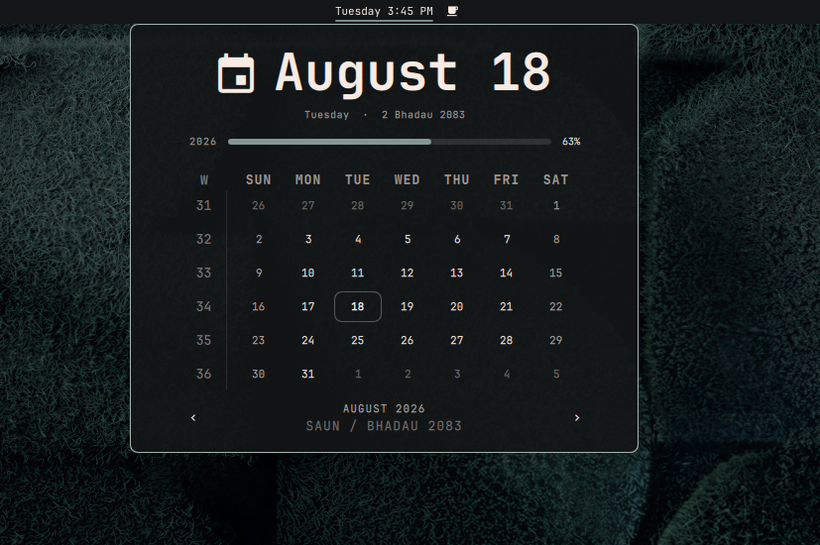
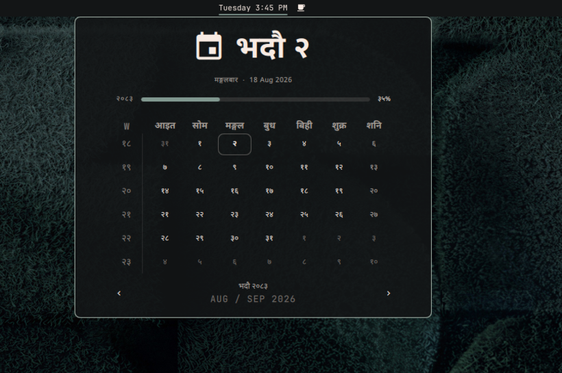

# Patro Clock

Omarchy's clock, with a Nepali **Bikram Sambat** calendar beside the Gregorian
one. Two-finger swipe sideways in the popup to cross between them.

It replaces the built-in clock rather than sitting next to it, so you get one
clock in the bar and one calendar popup — not a second date widget competing for
space.

| Gregorian | Nepali |
|:---:|:---:|
|  |  |

Both views are laid out to **exactly the same width and height**, so switching
never resizes or reflows the popup. Each one sets its own date large and names
the other calendar small — which is the pairing you actually want when you are
reading one and thinking in the other.

## Install

```bash
omarchy plugin add https://github.com/samirpokharel/omarchy-patro-clock.git --enable
```

Pick **center** when it asks for a section, then remove the built-in clock so you
do not have two:

```bash
omarchy plugin disable omarchy.clock
```

If the built-in clock was your bar's center anchor, point the anchor at this
plugin — otherwise the center section loses its pinned layout:

```bash
jq '.bar.centerAnchor = "samirpokharel.patro-clock"' ~/.config/omarchy/shell.json > /tmp/s \
  && mv /tmp/s ~/.config/omarchy/shell.json
```

Devanagari comes from `noto-fonts`, which Omarchy already installs. JetBrains
Mono has no Devanagari coverage, so the Nepali view asks for
`Noto Sans Devanagari` by name.

## Removing it

```bash
omarchy plugin remove samirpokharel.patro-clock
omarchy plugin enable omarchy.clock
```

If you repointed the bar's center anchor during install, point it back:

```bash
jq '.bar.centerAnchor = "omarchy.clock"' ~/.config/omarchy/shell.json > /tmp/s \
  && mv /tmp/s ~/.config/omarchy/shell.json
```

The plugin writes only its own entry in `~/.config/omarchy/shell.json`, and only
when you change one of its settings, so removing it leaves nothing else behind.

## Using it

| | |
|---|---|
| Two-finger horizontal swipe | switch calendar |
| `n` | switch calendar |
| Vertical scroll | step the month |
| `←` `→` or `[` `]` | step the month |
| `↑` `↓` or `{` `}` | step the year |
| `t` or click the hero | back to today |
| `w` or click the `W` heading | week start (Gregorian view only) |
| Left click the bar label | open the calendar |
| Right click the bar label | cycle the label format |
| Middle click the bar label | timezone picker |
| Double-tap the year rail | memento mori — set a birth year |

Optional hotkey, in `~/.config/hypr/bindings.conf`:

```
bindd = SUPER SHIFT, C, Patro Clock, exec, omarchy-shell samirpokharel.patro-clock toggle
bindd = SUPER SHIFT, N, Switch calendar, exec, omarchy-shell samirpokharel.patro-clock toggleCalendar
```

`toggleCalendar` works whether or not the popup is open, which makes it a decent
fallback if the swipe does not suit your touchpad.

## Settings

Under **Setup › Plugins**, or directly in `~/.config/omarchy/shell.json`.

| Key | | Default |
|---|---|---|
| `calendarSystem` | `bikram`, `gregorian` | `bikram` |
| `format` | Qt format for the bar label; `ww` becomes the ISO week | `dddd HH:mm` |
| `formatAlt` | second format in the right-click ring | `d MMMM 'W'ww yyyy` |
| `verticalFormat` | used when the bar is vertical | `HH\n—\nmm` |
| `weekStartDay` | `sunday`, `monday`; unset follows the locale | unset |
| `swipeThreshold` | sideways travel that counts as one swipe | `120` |
| `birthYear` | `0` hides the memento-mori bar | `0` |
| `lifeExpectancy` | years, only used with a birth year | `90` |

**If the swipe feels wrong,** `swipeThreshold` is the knob. Touchpads differ
wildly in how much scroll delta they report per gesture: raise it if the calendar
flips too eagerly, lower it if a full swipe does nothing.

## Notes on the Nepali view

- The week starts on Sunday and **Saturday** is the weekend, as a wall patro
  prints it. The week-start toggle is inert here, because a patro has no such
  choice to offer.
- Month and weekday names are the colloquial forms — भदौ, not भाद्र; साउन, not
  श्रावण.
- The week gutter counts the year in sevens from 1 Baisakh. Bikram Sambat has no
  ISO-week equivalent, so this is plainly "which seven-day block of the year is
  this" rather than a standard.
- Dates are covered for **2000–2090 BS**. Month lengths are published rather than
  derived (see [NOTICE.md](NOTICE.md)), so 2084 onward is provisional and the
  chevrons go inert at the ends of the table rather than inventing months.

## Not yet

- **The bar label is always Gregorian.** Switching the calendar changes the
  popup, not the label. Rendering a Bikram Sambat date in the bar needs its own
  format vocabulary, which is a separate piece of work.
- **No tithi, no holidays.** If you want the lunar day, Ekadashi/Purnima marks
  and a BS↔AD converter, [yogeshojha/patro](https://github.com/yogeshojha/patro)
  is a standalone bar widget that does all of that well.

## Development

```bash
node tests/bikram.test.js      # or: npm test
omarchy-plugin-validate .
```

Two things about hacking on this that will otherwise cost you an afternoon:

1. **Editing `Panel.qml` needs a full shell restart.** Omarchy logs
   `Local plugin changed, reloading`, but a file loaded through
   `Loader { source: Qt.resolvedUrl(...) }` keeps serving Qt's cached
   compilation. Your edit appears to do nothing, with no error. Run
   `omarchy-restart-shell`.
2. **`qmllint` is useless here** — it cannot resolve the `qs.*` imports and will
   pass a file with a deliberate typo in it. Use `qmlformat <file> >/dev/null`
   as a syntax check and read real errors from
   `quickshell -p /usr/share/omarchy/shell log`. Note the `-p`: plain
   `quickshell log` cannot find the running instance.

## Credits

Built on Omarchy's built-in clock and on the Bikram Sambat table from
[yogeshojha/patro](https://github.com/yogeshojha/patro), both MIT. See
[NOTICE.md](NOTICE.md) for exactly what came from where.

MIT licensed.
